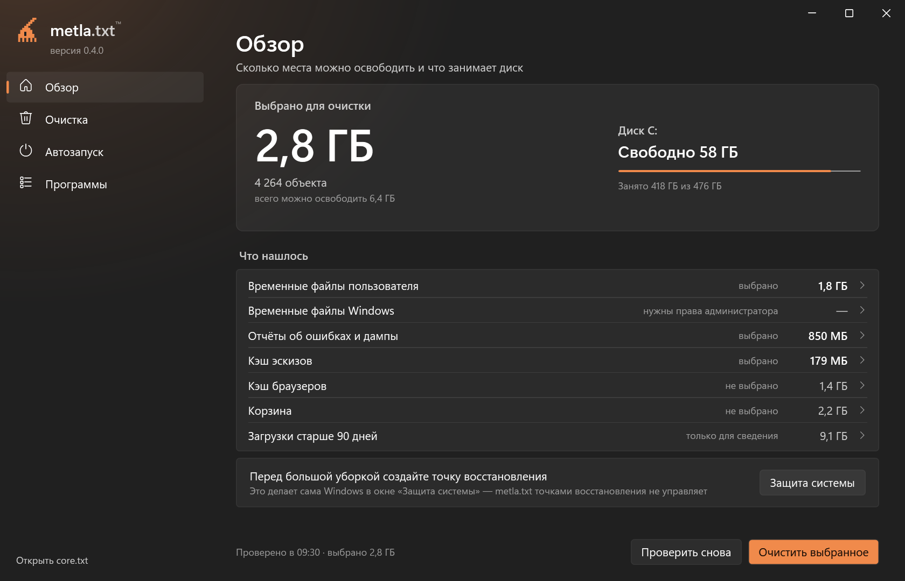
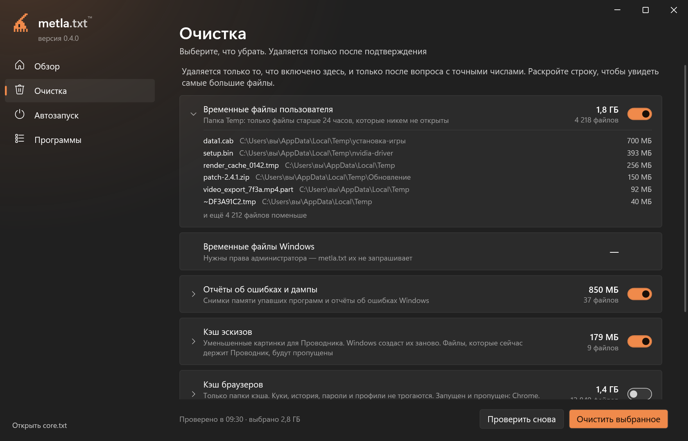
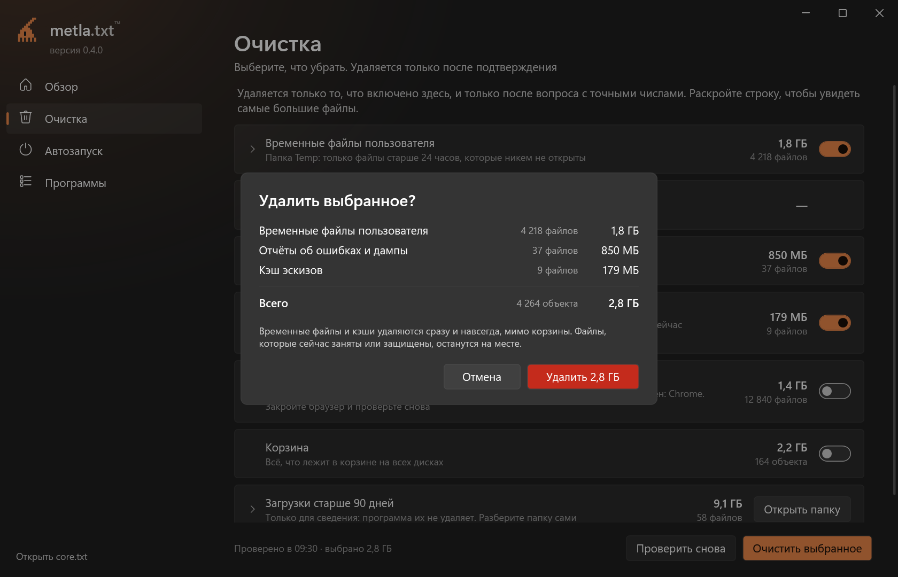
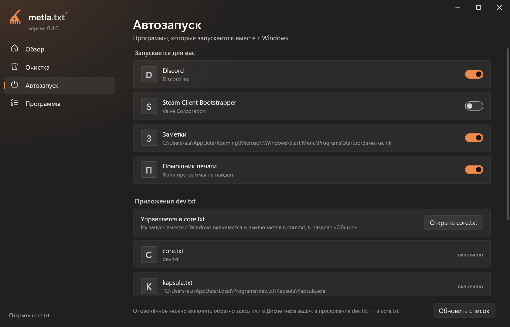
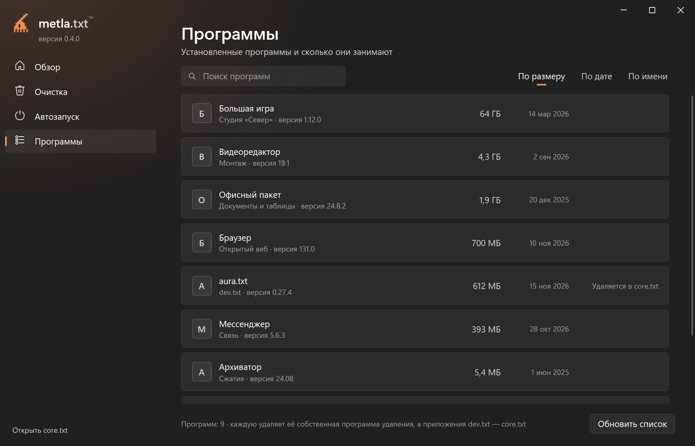

# metla.txt

Аккуратная уборка компьютера из семейства dev.txt™. Одно окно показывает, что занимает место и что запускается вместе с Windows, и убирает только то, что вы сами отметили и подтвердили.



Главное правило: программа удаляет файлы, поэтому она не должна удивлять. Ничего не удаляется, пока вы не увидели, что именно и сколько, и не нажали кнопку. Всё рискованное просто не предлагается.

## Что она делает

**Обзор.** После проверки — одно число: сколько можно освободить. Рядом — сколько занято и свободно на системном диске, ниже — категории с размерами. Сама проверка только читает диск и ничего не меняет.

**Очистка.** Категории строками: размер, число файлов, переключатель. Строку можно раскрыть и увидеть восемь самых больших файлов.



| Категория | Что это | Включена сразу |
|---|---|---|
| Временные файлы пользователя | папка `%TEMP%`: файлы старше 24 часов, которые никем не открыты | да |
| Временные файлы Windows | `%WINDIR%\Temp`, то же правило | да |
| Отчёты об ошибках и дампы | `%LOCALAPPDATA%\CrashDumps`, архив и очередь отчётов Windows (`%ProgramData%\Microsoft\Windows\WER\ReportArchive`, `ReportQueue`), файлы `*.dmp` в `%LOCALAPPDATA%\Temp` | да |
| Кэш эскизов | `thumbcache_*.db` в `%LOCALAPPDATA%\Microsoft\Windows\Explorer` — Windows создаёт их заново | да |
| Кэш браузеров | Chrome, Edge, Brave, Яндекс Браузер — папки `Cache`, `Code Cache`, `GPUCache` в профилях; Firefox — папка `cache2` | нет |
| Корзина | всё, что в ней лежит, на всех дисках | нет |
| Загрузки старше 90 дней | только список и кнопка «Открыть папку» | удалить нельзя |

Перед удалением программа показывает лист с числами по каждой выбранной категории и итогом.



**Автозапуск.** Что запускается вместе с Windows для вашей учётной записи: записи реестра `HKCU\…\Run` и ярлыки из вашей папки «Автозагрузка». Переключатель отключает запись так же, как Диспетчер задач, и так же её возвращает. Общие для всех пользователей записи (`HKLM\…\Run` и общая папка «Автозагрузка») показаны приглушённо и только для просмотра. Если файла программы на месте нет (запись осталась от удалённой или переехавшей программы), под названием так и написано: «Файл программы не найден».

Автозапуском приложений dev.txt (core.txt, kapsula.txt, aura.txt и остальных) ведает core.txt. Пока он установлен, они собраны в группу «Приложения dev.txt» без переключателей: строка «Управляется в core.txt» и кнопка «Открыть core.txt» — запущенный core.txt открывает страницу «Общие», незапущенный запускается сразу на ней (`Core.exe --page general`). Приложением dev.txt считается программа из `%LOCALAPPDATA%\Programs\dev.txt` или файл `Core.exe`, `Kapsula.exe`, `Aura.exe`, `Dock.exe`, `Smena.exe`, `Metla.exe`, если в его свойствах не указана другая компания. Без core.txt такие записи ничем не отличаются от остальных. Поставили или удалили core.txt, пока список открыт, — строки перестраиваются, когда вы вернётесь в окно.



**Программы.** Установленные программы: название, издатель, размер, дата установки; порядок по размеру, по дате или по имени; поиск. Кнопка «Удалить» после вопроса запускает собственную программу удаления этой программы.

Приложения dev.txt удаляет core.txt. Пока он установлен, у них вместо «Удалить» подпись «Удаляется в core.txt», а на строке под курсором — кнопка «Открыть core.txt» (страница «Приложения»). Их узнают по записи `dev.txt.<имя>` в реестре (её делает core.txt), по издателю `dev.txt` или по папке: `%LOCALAPPDATA%\Programs\dev.txt`, а у aura.txt — `%LOCALAPPDATA%\Programs\aura-voice`.



## Правила безопасности

1. **Сначала показать, потом спросить.** Удаление начинается только с кнопки на листе, где перечислены категории, число файлов и размер. Размер корзины перед вопросом считается заново.
2. **Временные файлы и кэши удаляются навсегда**, мимо корзины. Об этом сказано на листе. Корзина очищается целиком; стандартный вопрос Windows при этом не показывается, потому что свой вопрос уже задан.
3. **Только в своих папках.** Каждое удаление проходит через одну проверку (`Safe.Delete` в `src/Safe.cs`). Она отказывает, если файл лежит не строго внутри папки своей категории, если в пути есть `..`, если на пути встречается ссылка или точка соединения, и никогда не удаляет саму папку категории. По ссылкам программа не ходит и при проверке.
4. **Никакой настойчивости.** Файл открыт другой программой, защищён от записи или недоступен — он остаётся на месте и попадает в счётчик «пропущено». Повторных попыток, смены прав и снятия защиты нет.
5. **Свежее не трогается.** Во временных папках берутся только файлы старше 24 часов; возраст считается по более поздней из двух дат — создания и изменения. Файл, изменённый между проверкой и удалением, пропускается. Папка удаляется, только если она пуста (во временных папках — ещё и старше 24 часов); рекурсивного удаления в программе нет.
6. **Из браузеров — только кэш.** Куки, история, пароли, закладки и сами профили не затрагиваются. Пока браузер запущен, его кэш пропускается, и об этом написано в строке категории.
7. **Без прав администратора — без этой категории.** Если папку нельзя прочитать, в строке стоит «нужны права администратора», и она пропускается. Программа сама прав не запрашивает.
8. **Загрузки не удаляются вообще.** Это список для сведения: разобрать папку можете только вы.
9. **Автозапуск обратим.** Запись не удаляется. Программа пишет только отметку «включено/отключено» в `HKCU\Software\Microsoft\Windows\CurrentVersion\Explorer\StartupApproved` — ту же, что Диспетчер задач. Других записей в реестр программа не делает.
10. **Программы удаляет их собственная программа удаления.** metla.txt запускает строку `UninstallString` из реестра и больше ничего: файлы программ она не трогает. Если программе удаления нужны права администратора, разрешение спрашивает Windows — на виду, обычным окном. Системные компоненты, обновления и записи без программы удаления в списке не показаны.
11. **Приложения dev.txt — в core.txt.** Пока core.txt установлен, metla.txt не отключает их автозапуск и не запускает их удаление, а отправляет туда: у семьи на каждое дело одно место.

## Чего здесь нет и почему

- **Службы Windows.** Отключённая не та служба ломает систему так, что причину потом не найти.
- **Чистка реестра.** Места она не освобождает, скорости не прибавляет, а навредить может.
- **«Ускорители» и «игровые режимы».** За ними нет ничего, что можно честно показать числом.
- **Обновление драйверов.** Это дело Windows и производителя устройства.
- **Планировщик заданий.** Задания слишком разные, чтобы отключать их одним переключателем без риска.
- **Точки восстановления.** Ими управляет Windows. На странице «Обзор» есть совет создать точку перед большой уборкой и кнопка, которая открывает окно Windows «Защита системы» (`SystemPropertiesProtection.exe`). Сама программа точки не создаёт и не удаляет.
- **Работа в фоне.** Закрыли окно — программа закрылась. Исключение одно, и его включаете вы: напоминание (см. ниже).
- **Сеть.** Программа никуда не обращается, кроме хаба core.txt на этом же компьютере.

## Настройка в core.txt

metla.txt подключается к хабу core.txt как приложение `metla`:

- `metla.settings` — одна настройка: «Напоминать, когда можно освободить больше 5 ГБ». По умолчанию выключена. Пока она включена, программа после закрытия окна остаётся в фоне и раз в сутки сама делает ту же проверку только для чтения; если нашлось больше 5 ГБ — напоминает. Удаляете всё равно только вы и только из окна. Настройка выключена — значка в трее нет и в фоне ничего не работает; если окно в этот момент закрыто, программа закрывается совсем. Так её и останавливают, пока общий значок у core.txt: «Выхода» в общем меню трея у приложений нет.
- `metla.tray` — пункты в общем меню трея core.txt: «Открыть» и «Проверить диск» (окно на «Обзоре» и та же проверка только для чтения; пока идёт работа, пункт недоступен). Команда `tray.run` выполняет их. Те же пункты есть и в меню своего значка.
- `metla.found` — итог последней проверки: `{ "bytes": число, "at": "время в ISO" }`. `bytes` — сумма по всем категориям, которые программа умеет чистить (без загрузок и без того, что пропущено).
- команды `settings.set`, `show` и `tray.run`; команды «очистить» нет и не будет.
- `hub.theme`: при общем «Меньше движения» число на «Обзоре» не набегает, строки появляются сразу.
- `core.family` и `hub.apps` (общее для семьи, см. kit.txt `hub/PROTOCOL.md`, «Семья»):
  - **один значок в трее.** Пока core.txt на связи и держит общий значок (`tray: true`), своего значка у metla.txt нет — её пункты стоят в меню core.txt. Связь пропала или core.txt значок не держит — свой значок появляется сразу, с полным своим меню. Сразу после запуска, если core.txt установлен, свой значок до трёх секунд ждёт ответа core.txt, чтобы не мелькнуть; не дождался — появляется;
  - **напоминание на острове.** Если в `hub.apps` у kapsula.txt есть команда `notify`, напоминание уходит на остров (щелчок по карточке открывает окно metla.txt). Иначе — уведомление Windows от своего значка, как раньше;
  - **«Не беспокоить» и игра.** Пока в core.txt включено «Не беспокоить» или впереди игра (без core.txt — своя проверка окна на весь экран по общему правилу `FullScreen` из kit.txt), напоминание не показывается, а ждёт: пробует раз в минуту и при каждой вести от core.txt. Если общий значок у core.txt, а острова нет, свой значок появляется только на время уведомления Windows (его показывает лишь видимый значок) и потом снова прячется — когда Windows скажет, что уведомление закрыто, а самое позднее через минуту. Открыли окно — напоминание уже не нужно.

Без core.txt программа работает так же.

## Сборка

```bash
powershell -ExecutionPolicy Bypass -File build.ps1
```

Ничего ставить и скачивать не нужно: собирает компилятор, встроенный в Windows. Получается один файл `Metla.exe`. Номер версии — в `version.txt`.

## Проверка

```bash
./Metla.exe --selftest
./Metla.exe --demo --shot shot.png
./Metla.exe --scan-only
```

| Ключ | Что делает |
|---|---|
| `--selftest` | строит во временной папке собственное выдуманное дерево и проверяет на нём правила: 24 часа, занятые и защищённые файлы, отказы `Safe.Delete` (путь снаружи, `..`, точка соединения, сама папка, соседняя папка с похожим именем), итоги, очистку — оставшиеся файлы сверяются поимённо, отбор папок кэша в выдуманном профиле браузера. Отдельно — отметки автозапуска на байтах в памяти, отбор записей о программах на выдуманных данных, размеры по-русски, настройки и работу без хаба. Настоящие файлы, корзина и реестр не трогаются |
| `--demo` | выдуманное состояние; диск, реестр и сеть не читаются, удаление выключено. К хабу подключается, только если задан `METLA_HUB_PORT` |
| `--shot файл.png` | рисует окно в файл и выходит; на экране ничего не появляется |
| `--page имя` | страница: `обзор`, `очистка`, `автозапуск`, `программы` или `overview`, `cleanup`, `startup`, `programs` |
| `--state имя` | для снимков в `--demo`: `scan` — идёт проверка, `clean` — идёт очистка, `done` — итог очистки, `loading` — списки читаются |
| `--sheet`, `--expand id`, `--scroll N` | для снимков: показать вопрос перед очисткой, раскрыть категорию (`temp`, `dumps`, `thumbs`, `browsers`, `downloads`), прокрутить страницу |
| `--menu` | для снимка: вместо окна — меню своего значка в трее; с `--state scan` — пока идёт работа («Проверить диск» недоступен) |
| `--scan-only` | настоящая проверка только для чтения: печатает итоги и число файлов по категориям, число записей автозапуска и программ, ничего не удаляет и выходит |
| `--headless` | запуск без окна: только связь с хабом |

`METLA_HUB_PORT` — порт хаба вместо 42080, `METLA_DATA` — папка настроек вместо `%APPDATA%\dev.txt\metla`. Проверка связи без настоящего core.txt — с образцовым хабом из kit.txt:

```bash
node путь/к/kit.txt/hub/hub.js 48991
METLA_HUB_PORT=48991 METLA_DATA=./tmp-data ./Metla.exe --demo --headless
```

## Как это устроено

| Файл | Что это |
|---|---|
| `src/Safe.cs` | единственное место, где что-то удаляется с диска, и его правила |
| `src/Scan.cs` | категории, проверка, очистка, размеры по-русски, корзина |
| `src/Startup.cs` | автозапуск и список программ |
| `src/MainWindow.cs`, `src/Pages.cs` | окно, страницы, лист с вопросом, трей, выдуманное состояние для `--demo` |
| `src/AppHub.cs` | связь с хабом |
| `src/Program.cs`, `src/SelfTest.cs` | запуск, ключи, настройки; самопроверка |
| `src/Tokens.cs`, `src/Ui.cs`, `src/HubLink.cs`, `src/Family.cs`, `src/CoreApp.cs` | **копии из kit.txt, руками не правятся** (`tools/sync.ps1 путь\к\kit.txt`) |
| `sprite.json`, `assets/metla.ico` | значок: метла — черенок, головка с глазами, прутья |

## Не проверено

- **Настоящая очистка.** На живом компьютере удаление ни разу не запускалось: оно проверено только на выдуманном дереве в `--selftest`. То же с очисткой настоящей корзины.
- **Переключатель автозапуска.** Запись в реестр не выполнялась: проверены кодирование отметки на байтах в памяти и чтение списка. Что Диспетчер задач видит отметку так же, не проверено.
- **Запуск программ удаления.** Ни одна не запускалась: проверены разбор строки удаления и отбор записей.
- **Кэш браузеров на настоящем профиле.** На компьютере, где шла проверка, ни одного из пяти браузеров нет; отбор папок проверен только на выдуманном профиле. Процесс Яндекс Браузера определяется по имени `browser` — любая программа с таким именем будет принята за него, и кэш просто не тронут.
- **Запуск с правами администратора** и папка `Windows\Temp`, закрытая для чтения.
- **Трей и ежедневное напоминание**: значок, уведомление и суточный таймер вживую не проверялись.
- **Пути длиннее 260 знаков**: такие файлы не читаются и считаются пропущенными.
- **Работа с настоящим core.txt**: связь проверена с образцовым хабом из kit.txt.
- **Один значок в трее, остров и «Не беспокоить» вживую.** Логика проверена в `--selftest`, связь — с образцовым хабом (`--demo --headless`: `metla.tray`, `tray.run`, `settings.set`). Но в `--demo` нет ни своего значка, ни ежедневной проверки, поэтому прятание значка, отправка `notify` на остров, ожидание напоминания и значок, который появляется только на время уведомления, на настоящих core.txt и kapsula.txt не проверялись. Меню своего значка проверено только снимком (`--shot --menu`).
- В каталог core.txt приложение не добавлено, значок в `icons/sprites.json` kit.txt не внесён.
